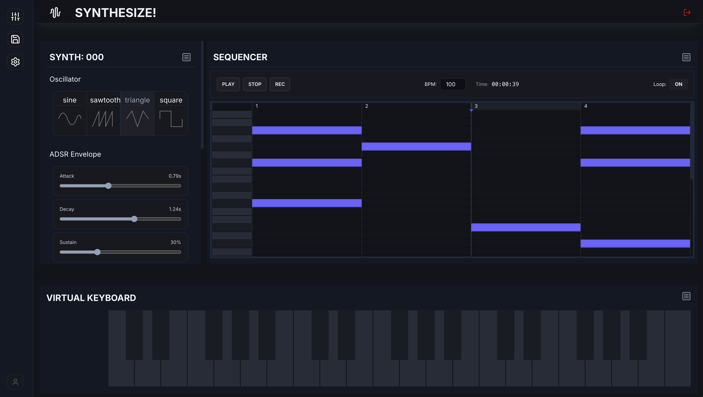
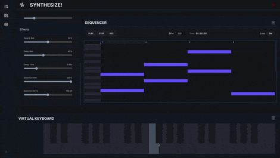
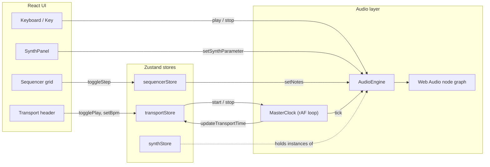
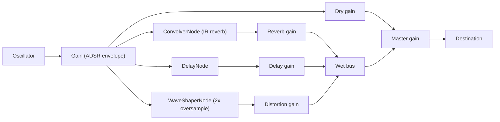

<div align="center">

# 🎹 Synthesize!

**A browser-based synthesizer and step sequencer built from scratch on the Web Audio API.**

Play it with your computer keyboard, shape the sound with an ADSR envelope and effects chain, and sequence loops on a piano-roll grid, all in real time, with no audio libraries.

[](https://synthesize-project.vercel.app/home)


</div>

<div align="center">



<sub>Playing the keyboard while the sequencer loops</sub>



</div>

---

## Overview

Synthesize! is a polyphonic browser synth with a built-in step sequencer. Everything you hear is generated live: oscillators, envelopes, reverb, delay and distortion are all wired up directly with the **Web Audio API**. There are no audio libraries like Tone.js.

I built it to go deep on the parts of front-end engineering that tutorials skip: **real-time audio timing**, **state management that lives outside the React render cycle**, **SSR-safe browser APIs**, and **composable component design**. It's my biggest project to date, and the sequencer scheduling bug I tracked down along the way is written up [below](#-deep-dive-the-sequencer-scheduling-bug).

## Features

| | |
|---|---|
| 🎹 **Playable keyboard** | Click or touch the on-screen keys, or play with your computer keyboard (a Z/Q/I row layout across 29 notes). Pointer events are used so it works on touch devices too. |
| 🎛️ **Sound design** | Switch between **sine, sawtooth, triangle, and square** oscillators, and shape each note with a full **ADSR envelope** |
| 🌊 **Effects chain** | **Convolution reverb** (real impulse responses), **delay** with adjustable time, and **soft-clip distortion** with adjustable drive. Each effect has its own wet/dry control. |
| 🔁 **Step sequencer** | Click cells on a 37-row piano-roll grid (C2 to C5) to place notes. A looping playhead follows the transport. |
| ⏱️ **Transport** | Play / stop, BPM from 40 to 240, and a live time readout |
| 🧩 **Fully client-side** | No backend, database, or environment variables. Deploys to Vercel as a standard Next.js app. |

## Tech Stack

| Layer | Choice | Why |
|---|---|---|
| Framework | **Next.js 16** (App Router) | File-based routing, easy Vercel deploys, and a real SSR constraint to design around |
| UI | **React 19** | Component model, plus `useSyncExternalStore` for subscribing to non-React state |
| Language | **TypeScript** (strict mode) | Typed note/MIDI events, parameter definitions, and store contracts |
| State | **Zustand 5** | Small, selector-based stores that can be read from *outside* React (essential for the audio loop) |
| Audio | **Web Audio API** | Sample-accurate scheduling and a real node graph, with no wrapper library |
| Styling | **Tailwind CSS 4** | Design tokens as CSS variables, with a dark synth-style theme |
| Icons | **lucide-react** | |
| Tooling | **pnpm**, **ESLint 9** | |
| Hosting | **Vercel** | |

## Architecture

The app is split into three layers: a **React UI**, a small set of **Zustand stores** that act as the source of truth, and an **audio layer** that owns the Web Audio graph and the clock.



### The three stores

- **`synthStore`** is a registry of `AudioEngine` instances keyed by ID. Components look up a synth by `synthID`, so the UI is not hard-wired to a single engine and multiple synths are structurally supported.
- **`transportStore`** holds playback state (`isPlaying`, `bpm`, `currentTime`, `currentBeat`, loop length). The playhead UI subscribes to it, and the audio engine reads it with `getState()` and subscribes to it directly, with no React in the audio path.
- **`sequencerStore`** holds the grid as a `Record<"col-row", MidiNoteEvent>`. Toggling a cell updates the store *and* pushes the flattened note list to the target engine.

### Audio signal chain

Each note gets its own oscillator and envelope gain, which fan out into a dry path and three parallel effect sends that meet at a shared wet bus:



## Engineering Highlights

### 🧩 Customizable, decoupled keyboard and piano components

The on-screen keyboard is built from small, independent pieces instead of one monolith:

- **`Key`** is a single playable key. It only needs a `note` and a `synthID`. A `useKeyboard` flag controls whether it also responds to the computer keyboard, which lets the *same component* serve as a playable key on the main keyboard **and** as the note-label gutter in the sequencer without double-triggering.
- **`Piano`** lays out a set of `Key`s and is configurable by props: `variant` (white or black layer), `isVertical`, `midiOffset` (transpose), and `numberOfKeys`. Black-key positions are computed as percentages of the white-key width, so it scales to any container.
- **`Keyboard`** composes two `Piano` layers (white keys underneath, black keys as an overlay) and passes down a `synthID`.

None of these depend on each other's internals. Any of them can be restyled, resized, or dropped into another layout, and note data lives in one `noteMap` that all of them share.

### 🗄️ Stores that sit outside the render cycle

Real-time audio can't wait on React renders. The stores are written so the audio code can read and subscribe to them directly, while the UI subscribes only to the slices it needs:

- Components subscribe to the slices they need (the BPM field, for example, selects only `bpm`) instead of reaching into a global context.
- `AudioEngine` exposes `subscribe` and `getSnapshot` and is consumed in React through **`useSyncExternalStore`**. The snapshot is cached and replaced only when a parameter changes, which keeps its reference stable, and a static server snapshot keeps hydration clean.

### 🛡️ SSR-safe Web Audio

`AudioContext` doesn't exist on the server, and browsers refuse to start it until a user gesture. The app handles both:

- The context is created **lazily** behind a getter that throws a clear error if touched server-side, and all store/engine initialization is guarded with `typeof window` checks.
- The page resumes a suspended context on the first `pointerdown` or `keydown`.

### 🔊 Voice management and signal quality

- Re-triggering a note that's still sounding fades the old voice out over ~10 ms before starting the new one, which avoids clicks and stuck voices.
- `stopAllVoices()` is wired to the transport, so hitting stop silences every active voice immediately.
- Distortion uses a custom waveshaper curve with 2x oversampling to reduce aliasing.
- Reverb uses real impulse responses from the bundled IR library (48 files: four decay lengths with twelve variants each), and `AudioEngine` has a `loadNewConvolverImpulse()` method for swapping them at runtime.
- All synth parameters are described declaratively (`synthParameters`: name, range, step, unit, default) and the control panel renders its knobs by mapping over that list, so the UI stays in sync with the parameter definitions.

## 🐛 Deep Dive: The Sequencer Scheduling Bug

This was the hardest problem in the project and took me the longest to solve. It's a good example of how I debug.

**Symptom:** I placed four notes in the sequencer and hit play. Only the first note was audible.

**Investigating:** The data looked fine. Logging showed all four notes were registered in the engine's note set, so this wasn't a store or UI problem. The failure was somewhere between "note exists" and "note is triggered."

**Testing a hypothesis:** I suspected the later notes weren't being triggered at all, and that I'd been fooled by the sound tail of the first one. To prove it, I set the oscillator **release to its maximum**. With a long enough release, the other "notes" suddenly became audible, which confirmed it: *only the first note was ever triggered, and the long release tail was the only reason anything else could be heard.* Shortening the release made them vanish again. Both behaviors were wrong.

**Root cause:** The clock was passing the **tempo value (120)** to the engine's scheduler where it expected a **lookahead window in seconds**. That meant the scheduler's horizon was effectively 120, not a few milliseconds, so scheduling decisions were made against the wrong time window and every note after the first was effectively ghosted.

**The fix:** The audio engine now owns its own **tiny local lookahead window** instead of trusting a value passed in from `clock.ts`, and the clock runs on `requestAnimationFrame`:

```ts
// AudioEngine.scheduleNotes(), condensed
const lookaheadWindow = 0.1; // seconds, local to the engine
const horizon = ctx.currentTime + lookaheadWindow;

this.notes.forEach((note, index) => {
  if (this.scheduledIndices.has(index)) return; // never double-trigger

  // Convert the note's position on the transport timeline into audio-hardware time
  const noteStartSec = note.beat * secondsPerBeat;
  const exactHardwareTime = ctx.currentTime + (noteStartSec - transport.currentTime);

  if (exactHardwareTime >= ctx.currentTime - tolerance && exactHardwareTime < horizon) {
    this.play(note.midi, Math.max(exactHardwareTime, ctx.currentTime), gateDurationSec);
    this.scheduledIndices.add(index);
  }
});
```

The scheduled-index set is cleared when the transport loops or stops, so each pass through the loop re-arms the notes exactly once. Driving the whole loop from `requestAnimationFrame` also made the playhead UI noticeably smoother and the timing more reliable.

**Takeaway:** When the symptom is "only the first thing works," check whether the *scheduling window* matches the *time units* of the thing feeding it. And when you suspect your own ears, find a way to make the test impossible to misread, as I did with the release time.

## Getting Started

### Prerequisites

- **Node.js 20+**
- **pnpm** (the repo pins its version in `package.json` via `packageManager`)

### Install and run

```bash
# 1. Clone the repo
git clone https://github.com/krsnelgrove-del/synthesizer-project.git
cd synthesizer-project

# 2. Install dependencies
pnpm install

# 3. Start the dev server
pnpm dev
```

Open [http://localhost:3000/home](http://localhost:3000/home).

No environment variables or database are required.

### Scripts

| Command | What it does |
|---|---|
| `pnpm dev` | Start the development server |
| `pnpm build` | Create a production build |
| `pnpm start` | Serve the production build |
| `pnpm lint` | Run ESLint |

> **Tip:** Browsers block audio until you interact with the page. Click anywhere or press a key once and sound will start.

## Controls

| Input | Action |
|---|---|
| **Z S X D C V G B H N J M** | Play C2 to B2 |
| **Q 2 W 3 E R 5 T 6 Y 7 U** | Play C3 to B3 |
| **I 9 O 0 P** | Play C4 to E4 |
| **Mouse / touch** | Click any on-screen key, including F4 to C5 |
| **Sequencer cell click** | Toggle a note on or off at that step |
| **PLAY / STOP** | Start or stop the transport (STOP also resets to the start) |
| **BPM field** | Set tempo (40 to 240) |

## Project Structure

```
src/
├── app/
│   ├── home/page.tsx          # Page entry: creates the synth, resumes AudioContext on first gesture
│   ├── classes/
│   │   ├── audioEngine.ts     # Oscillators, ADSR, effects graph, note scheduling
│   │   └── distortionTool.ts  # Waveshaper curve generator
│   ├── components/
│   │   ├── Content/
│   │   │   ├── keyboard/      # Keyboard, Piano, Key (decoupled, prop-driven)
│   │   │   ├── pianoRoll/     # Sequencer grid, cells, transport header
│   │   │   └── synthPanel/    # Oscillator, ADSR and effects controls
│   │   ├── customInputs/      # CustomKnob (parameter-driven range input)
│   │   └── sidebar/
│   ├── hooks/
│   │   └── useKeyboardInput.ts  # Computer-keyboard to note mapping
│   └── (const)/noteMap.tsx    # Single source of truth for notes, MIDI IDs and key bindings
├── (utils)/
│   ├── clock.ts               # MasterClock: rAF loop driving the transport and the engines
│   ├── synthStore.ts          # Engine registry
│   ├── transportStore.ts      # Playback state (bpm, time, beat)
│   ├── useSequencerStore.ts   # Sequencer grid state
│   ├── synthParameterUtils.ts # Parameter enums and types
│   └── midiHelpers.ts         # MIDI-to-frequency conversion
├── lib/                       # Reusable UI primitives (Container, buttons)
public/audio/impulses/         # Reverb impulse responses
```

## Roadmap

Known gaps and next steps:

- [ ] Note **duration resizing** in the sequencer (notes are fixed at one beat for now)
- [ ] **Loop** toggle and **record** (the buttons are in the UI; the behavior isn't wired up yet)
- [ ] **Export** audio and **save/load** presets
- [ ] UI for **swapping reverb impulse responses** (the engine already supports it)
- [ ] Multiple synth tracks (the store is already keyed by synth ID)
- [ ] Move the scheduling clock to a Web Worker so timing holds up in background tabs
- [ ] Automated tests for the scheduler and stores

## Credits

- Reverb impulse responses are sourced from REAPER (see [`public/audio/impulses/readme.txt`](public/audio/impulses/readme.txt) for the naming guide).

## Author

**Kyle Snelgrove**, full-stack software engineer.

[](https://www.linkedin.com/in/kyle-snelgrove/)
[](https://github.com/krsnelgrove-del)

If you've read this far, thanks for taking a look. Feedback and questions are welcome.
